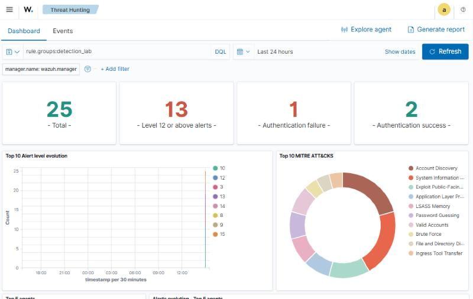
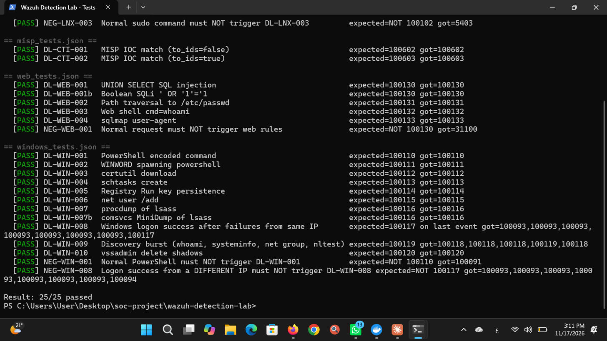
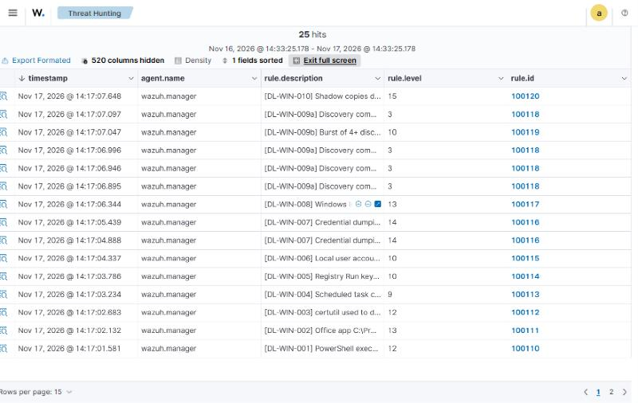
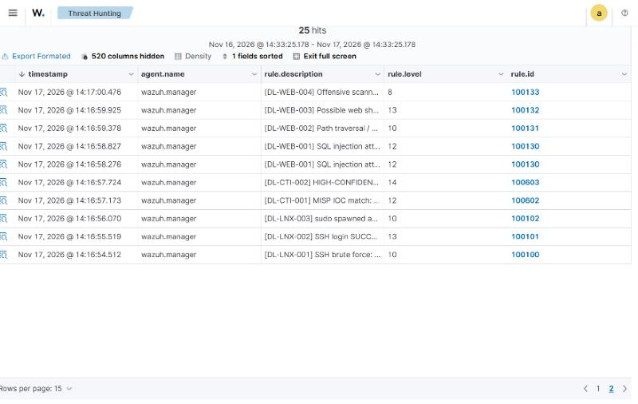
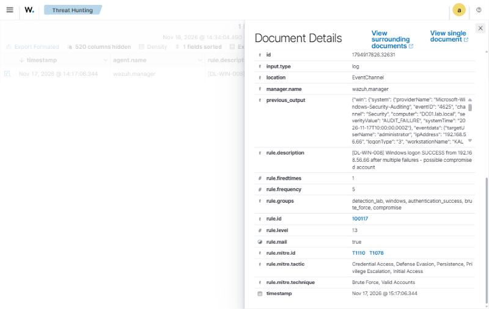
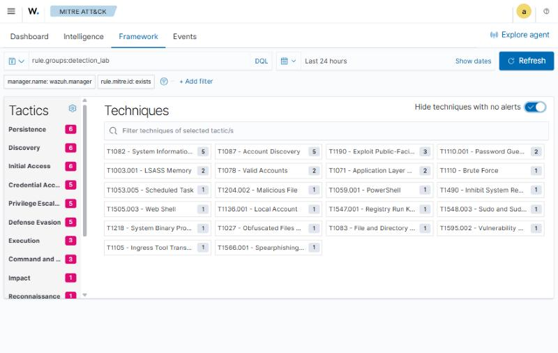

# Wazuh Detection Engineering Lab

Custom Wazuh detection rules for **Windows (Sysmon + Security log)**, **Linux / SSH**, **web servers** and **MISP threat intelligence**, every one mapped to **MITRE ATT&CK** and covered by an automated test suite that replays attack samples through the real Wazuh rule engine.

**27 detection rules · 31 ATT&CK techniques across 13 tactics · 40/40 tests passing (30 positive, 10 negative)** — Wazuh 4.9.2, single-node Docker.



## Highlights

- **Detection as code** – rules, tests and the ATT&CK layer live in one repo; one command deploys and tests everything.
- **Test-driven** – every alerting rule has a positive test; negative tests prove that benign activity stays quiet.
- **Correlation, not just matching** – brute force → successful logon from the same IP, bursts of discovery commands on one host.
- **Threat-intel enrichment** – a custom Wazuh integration looks up IOCs from alerts in MISP and raises its own alerts on matches.
- **ATT&CK coverage map** – a Navigator layer is generated straight from the `<mitre>` tags in the rules.
- **CI** – GitHub Actions validates every push: rule syntax, IDs, MITRE mapping, test coverage, and an up-to-date Navigator layer.

## Architecture

```
 Endpoints / log sources                Wazuh manager                               Wazuh indexer + dashboard
 ───────────────────────     ─────────────────────────────────────────────     ───────────────────────────────
 Windows (Sysmon, Security) ─┐   decoders → built-in rules ─┐                   alerts.json → Filebeat → indexer
 Linux (sshd, sudo)          ├─► (60000…, 5700…, 31100…)    ├─► custom rules ──► Threat Hunting / MITRE ATT&CK
 Apache / Nginx access logs ─┘                              │    100100-100133
                                                            │
                         integratord ── custom-misp.py ── MISP API (/attributes/restSearch)
                              ▲                │
                              └── alert        └── JSON "integration":"misp" event ──► rules 100600-100603
```

Windows rules attach to Wazuh's built-in rule **groups** (`sysmon_event1`, `sysmon_event_13`, `authentication_success`, `authentication_failed`) with `<if_group>` instead of hard-coded parent IDs. The same rule therefore works on live agents and in the test harness.

## Detection rules

| Tag | Rule | Level | Detects | ATT&CK |
|---|---|---|---|---|
| **Linux / SSH** — [`rules/100100-linux_rules.xml`](rules/100100-linux_rules.xml) |||||
| DL-LNX-001 | 100100 | 10 | SSH brute force: 6+ failed passwords from one IP in 60 s | T1110.001 |
| DL-LNX-002 | 100101 | 13 | SSH login **success** after 5+ failures from the same IP (300 s) | T1110.001, T1078 |
| DL-LNX-003 | 100102 | 10 | `sudo` spawning an interactive root shell | T1548.003 |
| DL-LNX-004 | 100103 | 13 | New account created with **UID 0** (backdoor root account) | T1136.001, T1078.003 |
| **Windows** — [`rules/100110-windows_rules.xml`](rules/100110-windows_rules.xml) |||||
| DL-WIN-001 | 100110 | 12 | PowerShell with a Base64 `-EncodedCommand` | T1059.001, T1027 |
| DL-WIN-002 | 100111 | 13 | Office app spawning cmd / PowerShell / script host (malicious macro) | T1566.001, T1204.002 |
| DL-WIN-003 | 100112 | 12 | `certutil` downloading from the internet (LOLBin) | T1105, T1218 |
| DL-WIN-004 | 100113 | 9 | Scheduled task created with `schtasks /create` | T1053.005 |
| DL-WIN-005 | 100114 | 10 | Registry Run / RunOnce key set (persistence) | T1547.001 |
| DL-WIN-006 | 100115 | 10 | Local account created with `net user /add` | T1136.001 |
| DL-WIN-007 | 100116 | 14 | Credential dumping: mimikatz, `procdump -ma lsass`, `comsvcs MiniDump` | T1003.001 |
| DL-WIN-008 | 100117 | 13 | Logon **success** after 5+ failures from the same IP (300 s) | T1110, T1078 |
| DL-WIN-009a | 100118 | 3 | Single discovery command (input for 009b) | T1082, T1087 |
| DL-WIN-009b | 100119 | 10 | 4+ discovery commands on one host in 120 s (hands-on-keyboard) | T1082, T1087 |
| DL-WIN-010 | 100120 | 15 | Shadow copies deleted / recovery disabled (ransomware precursor) | T1490 |
| DL-WIN-011 | 100121 | 12 | Security audit log cleared (event 1102) | T1070.001 |
| DL-WIN-012 | 100122 | 12 | Event log cleared from the command line (`wevtutil cl`, `Clear-EventLog`) | T1070.001 |
| DL-WIN-013 | 100123 | 12 | PsExec-style remote execution service installed (event 7045) | T1569.002, T1021.002 |
| DL-WIN-014 | 100124 | 12 | Remote command execution via WMI (`/node:`), WinRM (`Invoke-Command`, `winrs`) or PsExec | T1047, T1021.006, T1021.002 |
| DL-WIN-015 | 100125 | 10 | Data staged in a password-protected 7-Zip / RAR archive | T1560.001 |
| DL-WIN-016 | 100126 | 13 | Exfiltration with rclone to a cloud remote or upload with `curl -T` / `-F file=@` | T1567.002, T1048 |
| **Web** — [`rules/100130-web_rules.xml`](rules/100130-web_rules.xml) |||||
| DL-WEB-001 | 100130 | 12 | SQL injection in the URL (UNION SELECT, `' OR '1'='1`, `sleep()`, …) | T1190 |
| DL-WEB-002 | 100131 | 10 | Path traversal / LFI (`../../etc/passwd`, encoded variants) | T1190, T1083 |
| DL-WEB-003 | 100132 | 13 | Web shell command execution (`shell.php?cmd=whoami`) | T1505.003 |
| DL-WEB-004 | 100133 | 8 | Offensive scanner user-agent (sqlmap, nikto, nuclei, gobuster, …) | T1595.002 |
| **Threat intel (MISP)** — [`rules/100600-misp_rules.xml`](rules/100600-misp_rules.xml) |||||
| DL-CTI-001 | 100602 | 12 | IOC from an alert matches a MISP attribute | T1071 |
| DL-CTI-002 | 100603 | 14 | High-confidence match (attribute marked `to_ids`) | T1071 |

## Testing

### How the tests work

[`scripts/run_tests.py`](scripts/run_tests.py) replays every case in `tests/*_tests.json` through the manager's **logtest engine** (Wazuh API `PUT /logtest`). All events of a case share one logtest session, so frequency and correlation rules are tested too. A case asserts one of:

| Field | Meaning |
|---|---|
| `expect_rule` | the rule must fire on at least one event |
| `expect_rule` + `expect_on_last` | the rule must fire on the **last** event (correlation) |
| `expect_not_rule` | the rule must **not** fire (negative test) |

```json
{
  "id": "DL-WIN-008",
  "description": "Windows logon success after failures from same IP",
  "log_format": "eventchannel",
  "events": ["<7 x event 4625 from 192.168.56.66>", "<1 x event 4624 from 192.168.56.66>"],
  "expect_rule": "100117",
  "expect_on_last": true
}
```

The negative tests each change one thing compared to a positive case:

| Test | Proves that… |
|---|---|
| NEG-LNX-003 | a normal `sudo apt update` is not reported as a root shell |
| NEG-WEB-001 | a normal request with query parameters is not SQL injection |
| NEG-WIN-001 | normal PowerShell without `-EncodedCommand` does not fire DL-WIN-001 |
| NEG-WIN-008 | a logon success from a **different** IP after the failures does not fire DL-WIN-008 |
| NEG-LNX-004 | a normal `useradd` (UID 1001) is not a backdoor account |
| NEG-WIN-012 | `wevtutil qe` (query) is not log clearing |
| NEG-WIN-013 | a normal service install (Chrome elevation service) is not PsExec |
| NEG-WIN-014 | a local WMI query (`wmic os get caption`) is not remote execution |
| NEG-WIN-015 | an archive **without** a password is not staging |
| NEG-WIN-016 | `rclone copy` to a local drive (`D:\Backup`) is not exfiltration |

### Run everything

```powershell
powershell -ExecutionPolicy Bypass -File .\scripts\deploy_and_test.ps1
```

[`deploy_and_test.ps1`](scripts/deploy_and_test.ps1) copies the repo into the manager container, installs the rules and fixtures, validates them with `wazuh-analysisd -t` (it stops before restarting the manager if a rule is broken), restarts the manager and runs the test suite. Results are written to `test-output.txt` and `test-results.json`. `run_tests.py` exits with code 1 if any test fails, so it can gate a pipeline. It reads the API endpoint and credentials from `WAZUH_API_URL`, `WAZUH_API_USER` and `WAZUH_API_PASS`, and falls back to the defaults of the wazuh-docker single-node deployment.



Static checks need no Wazuh at all:

```bash
python scripts/validate_rules.py
```

They check that every file is valid XML, that rule IDs are unique and inside the custom range, that every `[DL-…]` alerting rule has a valid MITRE ID, and that every `[DL-…]` rule above level 3 has at least one positive test. [`.github/workflows/detection-ci.yml`](.github/workflows/detection-ci.yml) runs these checks on every push and pull request. It also regenerates the ATT&CK layer and fails if the committed one is out of date.

### Test fixtures for Windows events

`wazuh-logtest` cannot run Wazuh's internal `windows_eventchannel` decoder, so replayed Windows events are decoded as plain JSON and never reach the built-in Windows rule tree. [`tests/fixtures/100090-logtest_windows_fixtures.xml`](tests/fixtures/100090-logtest_windows_fixtures.xml) rebuilds the same groups for JSON-decoded events. Because the detection rules use `<if_group>`, they attach to the real built-in rules on live agents and to the fixtures in tests. On a real manager the fixtures never match agent events, which are decoded as `windows_eventchannel`.

## Seeing the alerts in the dashboard

`run_tests.py` uses logtest, which stores nothing. To demo the rules in the Wazuh dashboard, [`scripts/replay_alerts.py`](scripts/replay_alerts.py) sends the same samples to analysisd's local queue socket, exactly like a log collector does, so they become **real alerts** (`alerts.json` → Filebeat → indexer):

```bash
docker exec single-node-wazuh.manager-1 /var/ossec/framework/python/bin/python3 /tmp/dl/scripts/replay_alerts.py
```

Then open **Threat Hunting → Events** and filter with `rule.groups:detection_lab`.

| | |
|---|---|
|  |  |
| Windows alerts | Web, threat-intel and Linux alerts |
|  |  |
| DL-WIN-008 alert: `previous_output` holds the correlated failures | Techniques covered by the lab's rules |

## MITRE ATT&CK coverage

The rules cover **31 techniques across 13 tactics**, from Reconnaissance to Exfiltration and Impact. [`scripts/build_navigator_layer.py`](scripts/build_navigator_layer.py) reads the `<mitre>` IDs of every `[DL-…]` rule and writes [`mitre/detection-lab-layer.json`](mitre/detection-lab-layer.json). The score of each technique is the highest rule level that covers it, and the comment lists the rules. To view it, open the [ATT&CK Navigator](https://mitre-attack.github.io/attack-navigator/) → *Open Existing Layer* → *Upload from local*.

```bash
python scripts/build_navigator_layer.py
```

## MISP threat-intel integration

[`integrations/custom-misp.py`](integrations/custom-misp.py) is a Wazuh `integratord` script (standard library only):

1. Wazuh calls it for alerts in the groups listed in [`ossec.conf.snippet.xml`](integrations/ossec.conf.snippet.xml): Sysmon network/DNS, web, authentication, FIM.
2. It extracts IOCs: public IPs, domains, URL hosts and file hashes.
3. It looks each one up in MISP with `POST /attributes/restSearch`.
4. It writes the result back to analysisd as a JSON event (`"integration": "misp"`). Rules 100602 and 100603 turn matches into alerts, and 100601 reports API errors.

It never enriches its own MISP events, to avoid loops. Install it on the manager:

```bash
cp integrations/custom-misp.py /var/ossec/integrations/
chown root:wazuh /var/ossec/integrations/custom-misp.py
chmod 750 /var/ossec/integrations/custom-misp.py
# add integrations/ossec.conf.snippet.xml to ossec.conf (set hook_url and api_key), then restart the manager
```

TLS verification against MISP is off by default for lab use; set `MISP_VERIFY_TLS=true` in production.

## Lessons learned

- **Correlation inputs must alert.** analysisd drops an event whose final rule is level 0 *before* storing it in the `if_matched_sid` / `if_matched_group` history. A level-0 "logon failure" rule can therefore never be counted by a brute-force rule. DL-WIN-008 failed for exactly this reason until the failure fixture was raised to level 5, the same as the built-in rule 60122.
- **Every correlation rule needs a negative twin.** DL-WIN-008 and NEG-WIN-008 differ only in the source IP of the final logon. Together they prove that `<same_field>win.eventdata.ipAddress</same_field>` is what decides the result.
- **Tests catch regex bugs that reviews miss.** DL-WIN-016 first used `curl(\.exe)?\s+.*\s-F`. The `\s+` after `curl.exe` consumes the only space, so `\s-F` can never match `curl.exe -F …`. The positive test DL-WIN-016b failed and exposed it. The fix is `\s(.*\s)?-F`.
- **Don't trust built-in ATT&CK mappings blindly.** Wazuh's rule 60117 (event 1102, audit log cleared) maps to T1070.004 *File Deletion*. DL-WIN-011 re-tags it as T1070.001 *Clear Windows Event Logs* and raises it from level 9 to 12.
- **logtest ≠ live pipeline.** logtest is perfect for fast unit tests but writes no alerts and skips the `windows_eventchannel` decoder. Dashboard demos need a real replay through the queue socket.

## Repository layout

```
wazuh-detection-lab/
├── .github/workflows/         CI: static checks + ATT&CK layer freshness on every push
├── rules/                     custom detection rules (deployed to /var/ossec/etc/rules)
├── tests/
│   ├── *_tests.json           test cases (positive + negative)
│   └── fixtures/              logtest-only rules for JSON-decoded Windows events
├── scripts/
│   ├── deploy_and_test.ps1    deploy to the Docker manager + run all tests
│   ├── run_tests.py           logtest-based test runner (Wazuh API)
│   ├── validate_rules.py      static checks (no Wazuh needed)
│   ├── replay_alerts.py       replay samples as real alerts for the dashboard
│   └── build_navigator_layer.py
├── integrations/              MISP enrichment script + ossec.conf snippet
├── mitre/                     ATT&CK Navigator layer
└── screenshots/               test runs, logtest output, dashboard
```

## Screenshots

| File | Shows |
|---|---|
| [01](screenshots/01-tests-run-part1.jpg), [02](screenshots/02-tests-run-part2-25-of-25-passed.jpg) | Full test run: deploy, restart, 25/25 passed |
| [03](screenshots/03-logtest-DL-WIN-008-alert-100117.jpg) | `wazuh-logtest`: 7 failures + 1 success → rule 100117, level 13, T1110/T1078 |
| [04](screenshots/04-logtest-NEG-WIN-008-no-alert.jpg) | Same sequence, success from another IP → no alert |
| [05](screenshots/05-wazuh-manager-logs.jpg) | Rule files on the manager, `ossec.log`, `wazuh-analysisd -t` OK |
| [06](screenshots/06-dashboard-threat-hunting-overview.jpg), [07](screenshots/07-dashboard-events-detection_lab-25-hits.jpg) | Dashboard overview: 25 alerts, 13 at level 12+ |
| [08](screenshots/08-dashboard-alerts-windows.jpg), [09](screenshots/09-dashboard-alerts-web-cti-linux.jpg) | All alerts by rule ID and level |
| [10](screenshots/10-dashboard-alert-100117-event-data.jpg), [11](screenshots/11-dashboard-alert-100117-rule-mitre.jpg) | DL-WIN-008 alert details: event data, rule, MITRE, correlated events |
| [12](screenshots/12-dashboard-mitre-attack-overview.jpg), [13](screenshots/13-dashboard-mitre-framework-coverage.jpg) | MITRE ATT&CK module: tactics and covered techniques |

## Author

Mohamad Al Jazarah
